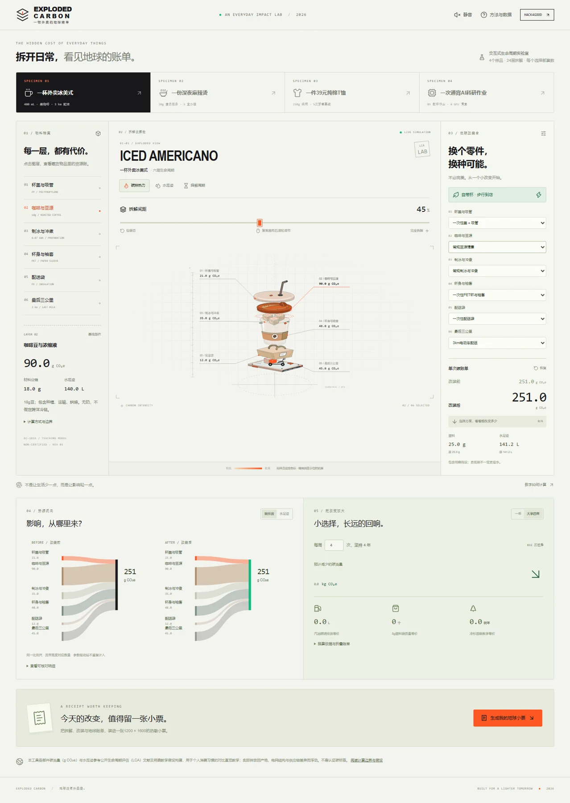
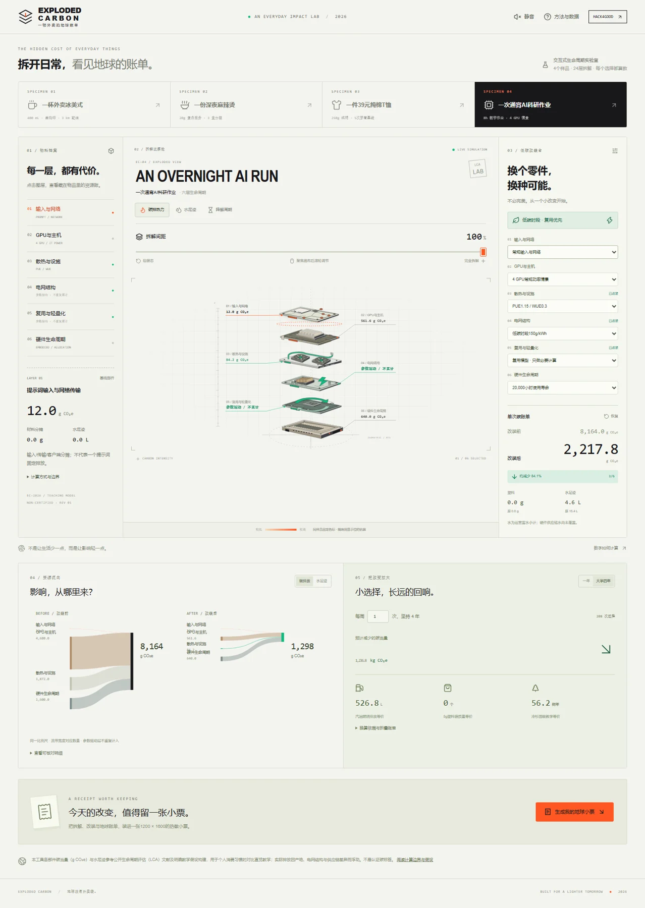
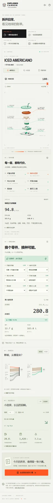

<div align="center">

# EXPLODED CARBON
### 一顿外卖的地球账单

**拆开日常，看见地球的账单。**

A browser-native, interactive life-cycle footprint laboratory.

[在线体验 / Live Demo](https://exploded-carbon-m33wci77q34.qoder.zone) · [设计与交互](#设计与交互) · [本地运行](#本地运行) · [科学边界](#科学边界)

`React 19` · `TypeScript` · `Vite 8` · `Tailwind CSS 4` · `SVG / Canvas` · `Web Audio`

**2026 Qoder 高校创造力大赛 · Hack4Good 技术向善赛道作品**



</div>

## 不只是一个碳计算器

一杯咖啡、一份麻辣烫、一件廉价 T 恤、一次通宵 AI 科研作业——日常选择背后的原料、能源、包装与运输，被拆成可观察、可替换的工程图层。

拖动拆解滑块，看物品沿 Z 轴展开；切换碳、水、降解视图；替换一个部件，观察资源账单如何变化。最后，把这次选择打印成一张地球热敏小票。

> 不必让生活少一点。让影响，轻一点。

## 设计与交互

| 模块 | 能做什么 |
| :--- | :--- |
| **4 个样品 / 24 个图层** | 冰美式、麻辣烫、棉 T 恤、AI 作业，每件 6 层独立选择与改装 |
| **工业爆炸图** | 原生 SVG 等距几何、材质厚度、工程引线、0–100% 拆解；支持滑块、键盘与聚焦画布后的滚轮 |
| **三种观察模式** | 碳排热力、水足迹、材料环境归趋；未知与不适用不冒充零 |
| **低碳改装台** | 部件选项、组合方案、恢复基线，实时联动碳排、塑料与水足迹 |
| **原生桑基流** | 改装前后同一比例尺，逐项可查；AI 参数驱动层不重复相加 |
| **年度 / 四年账单** | 独立消费频次，汽油、塑料袋质量、树年教学等价 |
| **地球热敏小票** | 本地 Canvas 生成 1200 × 1600 PNG，含线框、条码、明细与科学边界 |
| **机械反馈音** | 原生 Web Audio 合成，默认静音、手势开启，无音频文件 |

<table>
<tr><td align="center"><br><b>把一杯咖啡拆成六层证据</b></td><td align="center"><br><b>让虚拟计算的物理代价可见</b></td></tr>
</table>

<details>
<summary><b>移动端也可以完整实验</b></summary>
<br>

</details>

## 从设计到工程的约束

- **纯前端静态运行**：零后端、免登录，无运行时外部 API。
- **零外部素材依赖**：系统字体；所有图形、动画连线与流向均为原生矢量；所有反馈音本地合成。
- **同一计算源**：图层、总计、桑基流、年度账单、小票均读取同一核算结果。
- **可访问操作**：键盘焦点、原生表单、弹窗焦点恢复、减少动画偏好、窄屏布局。
- **隐私优先**：无需上传消费记录，无分析追踪；小票只在当前设备生成。

## 本地运行

Node.js **^22.13.0 或 >=24.0.0**，使用 npm 锁文件安装。

```bash
npm ci
npm run dev
```

生产构建与静态预览：

```bash
npm run build
npm run preview
```

最终静态文件位于 `dist/`，可部署到支持静态文件的托管平台。没有需要配置的服务端密钥。

## 可复现验证

```bash
npm run validate:data
npm run test:unit
npm run test:coverage
npm run build
npm run check:static
```

端到端验收使用 Python 3.11+、Playwright 与 Pillow：

```bash
python -m pip install playwright pillow
python -m playwright install chromium
# 在另一个终端启动 npm run preview 后运行：
python tests/e2e_lab.py --base-url http://127.0.0.1:4173
```

脚本将真实点击图层、拖动滑块、切换透视、改装、下载并解码 PNG，同时监测页面与网络错误；记录写入本机 `artifacts/`，不纳入仓库。

| 本地工程验收 | 结果 |
| :--- | :--- |
| 全部离散改装组合 | **288 / 288**：咖啡 64、麻辣烫 96、T 恤 64、AI 64 |
| 单元测试 | **23 / 23**，无跳过 |
| 已测模块行覆盖率 | **99.73%**，仅数据、引擎、状态与几何，不含所有 UI/Audio/Canvas |
| PNG 导出 | 四样品、移动端及断网情景，实际下载 **1200 × 1600** 文件 |
| 桌面 / 移动端 | 1440 × 900、390 × 844 |
| 资源独立性 | 测试中零外部资源请求；加载后断网仍可操作和导出 |

算术验证不等于科学核证；浏览器音频节点测试不等于人工听感评审。

## 科学边界

**这是教学模型，不是经过认证的碳标签、企业盘查或碳抵消工具。**

公开生命周期评估资料用于说明数量级与比较方法；多数零件级分配、包装、电网、降解年限与树年系数为明确披露的教学假设。地域、电网、产地、功能单位和供应链变化都会影响结果。应用内“方法与数据”可查看逐层公式与限制。

- **咖啡**：普通冰美式不含奶，不假定所有咖啡豆冷链运输。自带杯计制造摊销与清洗，可能省碳但增水。
- **食品**：主蛋白按相同 20g 蛋白服务换算，不把每 100g 蛋白的数据当作每 100g 食材；不宣称完全营养等效。
- **T 恤**：按相同穿着服务比较，延长寿命只改变分摊，不让整件制造排放消失。
- **AI**：8 小时情景，显式计 GPU、主机、PUE、WUE、电网与硬件摊销。电网/复用层为驱动，不重复累计；不宣称 Qoder 产品存在已测得的减排百分比。
- **水足迹**：区分绿水、蓝水与灰水；不是等量饮用水。硬件供应链水未覆盖的部分明确标记。
- **降解与等价物**：碎裂不等于完全生物降解；树年是教学等价，不表示真实植树或认证抵消。

### 参考资料

- [Usva et al. — Carbon and water footprint of coffee consumed in Finland](https://link.springer.com/article/10.1007/s11367-020-01799-5)
- [Nab & Maslin — Coffee life-cycle scenarios](https://rgs-ibg.onlinelibrary.wiley.com/doi/full/10.1002/geo2.96)
- [Poore & Nemecek / Our World in Data — Emissions per 100g protein](https://ourworldindata.org/grapher/ghg-per-protein-poore)
- [Waterwise — Virtual water footprint](https://waterwise.org.uk/virtual-water-footprint/)
- [US EPA — Greenhouse gas equivalencies calculations](https://www.epa.gov/energy/greenhouse-gas-equivalencies-calculator-calculations-and-references)

## 项目结构

```text
src/
├── data/          样品、变体、来源和明确假设
├── domain/        纯核算引擎、单位与年度换算
├── state/         独立样品状态、组合与恢复
├── graphics/      共享矢量路径、投影与爆炸变换
├── components/    实验台、改装、桑基、账单与弹窗
├── audio/         Web Audio 原生合成
└── export/        Canvas 小票与本地条码
scripts/           数据和静态产物校验
tests/             算术、状态、几何、真实浏览器验收
docs/images/       README 展示用本地优化截图
```

## 致谢与署名

使用 Qoder Sites React starter 的静态构建基础与可访问 UI 原语；依赖及样式来源请参阅 [PROVENANCE.md](PROVENANCE.md) 与 `vendor/` 中保留的许可信息。项目截图均来自本应用的真实浏览器渲染。

---

<div align="center">

**EXPLODED CARBON · 地球没有外卖袋。**

Built for a lighter tomorrow.

</div>
